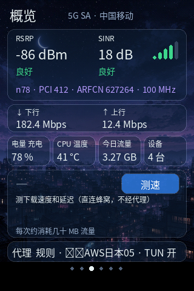
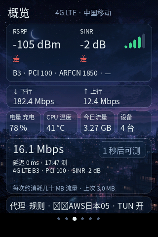
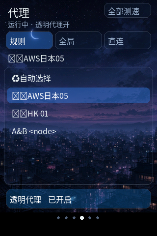
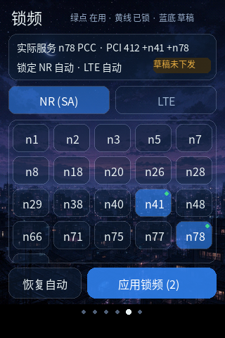
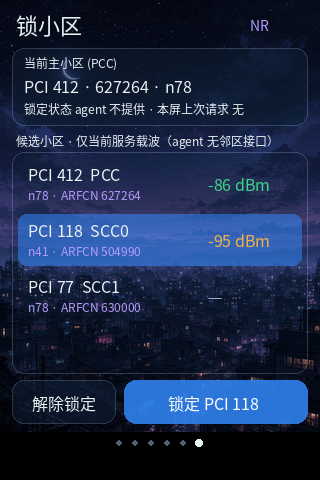
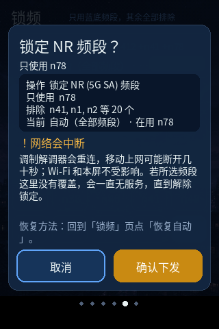

# U60-Pro-ScreenUI

中兴 U60 Pro（MU5250）机身 320×480 触摸屏扩展：在原厂桌面左右滑动即可使用概览、代理、锁频、锁小区和蜂窝测速。

本仓库**不是** Web 控制台的分支，也不包含中兴原厂固件。它是一层加载到原厂桌面程序里的扩展，通过 [peter5842/U60-Pro-WebUI](https://github.com/peter5842/U60-Pro-WebUI) 的 agent 接口读写设备状态。U60-Pro-WebUI 本身是 [dklasens/MU5250-OpenUI](https://github.com/dklasens/MU5250-OpenUI) 的分支，并可追溯到 [jesther-ai/open-u60-pro](https://github.com/jesther-ai/open-u60-pro)。

当前预编译版本：`screen.so` sha256 `55a8ae8b04cd9796c20b65d44848c05fa6700e3566cfdf5a524d59a3aacde5bb`。下面的界面图由测试里记录的真实控件树离线渲染，布局和文案与设备上一致，但不是真机拍照。

| 概览 | 测速完成 |
|---|---|
|  |  |
| 代理 | 锁频 |
|  |  |
| 锁小区 | 确认下发 |
|  |  |

更多画面：[测速进行中](preview/f-speed-running.png)、[已下发](preview/f1-result-sent.png)、[设备已确认](preview/f2-result-confirmed.png)、[下发失败](preview/f3-result-failed.png)。

## 和 Web 后台的关系

[U60-Pro-WebUI](https://github.com/peter5842/U60-Pro-WebUI) 提供设备上的 Rust agent（默认 `http://192.168.0.1:9090`）和浏览器里的 React 控制台（默认 `:8080`）。概览、锁频、锁小区、代理这些能力，后台里大多已经有了。

本项目做的是另一层：**把常用操作做到设备自己的屏幕上**，不打开电脑或手机也能看信号、切节点、锁频和测速。屏幕扩展会用设备里已有的 agent 密码登录（`/data/local/tmp/start_zte_agent.sh` 中的 `ZTE_AGENT_PASSWORD`），再带 Bearer token 调用接口。它不会绕过后台登录，也不会改你的密码。

当前实现针对的是：

- 设备：ZTE U60 Pro（MU5250）
- 固件：`BD_CNMU5250V1.0.0B31`
- 原厂桌面程序 `/usr/bin/zte_topsw_devui` 的 sha256 必须是  
  `e3914e78a8488cb736770f0ac9fb8ce10e0e5222fa50285f08e9e8be90d7f1e9`
- 后台：U60-Pro-WebUI 这一套 agent API（见下方接口列表）

换固件、换另一套后台，或桌面程序哈希不一致，`run.sh` 会拒绝加载扩展，界面退回原厂两页。

## 功能

左右滑动共 6 页：原厂第 1 页、原厂第 2 页、**概览**、**代理**、**锁频**、**锁小区**。

- **概览**（只读 + 测速）：网络类型和运营商；RSRP / SINR 大字和评级；PCC 频段、PCI、ARFCN、带宽和载波聚合；上下行速率；电量、充电、CPU 温度、今日流量、已连接设备数；底部一行显示代理模式和当前节点，点它跳到代理页。数据过期会标黄；agent 连不上或登录失败时清空数值并给出原因。
- **测速**（在概览页）：大字号 Mbps 和「测速 / 停止」按钮。下载在独立线程进行，最长 10 秒或 50 MB，可随时停止；实时显示速度、已下载量和延迟。延迟是对 `223.5.5.5:53` 做 3 次 TCP 握手取中位数，不做上传测试。结果会附上开始时的网络类型、频段、PCI 和 SINR，内存中保留最近 5 次。两次测速至少间隔 30 秒；测速和锁频/锁小区不能同时进行。测速固定走蜂窝网卡直连（绑定 WAN 接口及其 IPv4，自建 DNS，拒绝 `198.18.0.0/15` 的 fake-ip），不经过 mihomo 代理；直连失败就报失败，不会改走代理。默认地址是阿里云 Ubuntu 镜像，备选华为云镜像。
- **代理**：切换工作模式、当前节点，以及原有的节点测速。这一页沿用扩展里已有的代理界面。
- **锁频**：NR(SA) / LTE 两个标签。频段列表来自 `/api/modem/capabilities`。绿点是正在服务的频段，黄线是当前锁定，蓝底是草稿。点芯片只改草稿；「应用锁频」和「恢复自动」都要先出现确认框，点「确认下发」才会真正发送。若设备当前是自动（锁定集合等于全部支持频段；LTE 以掩码 `0x87e29a0e00df` 判断），草稿从空开始，点选表示「只使用」这些频段；空草稿不能下发。所选频段本机从未见过信号时，确认框会红字提示可能断网。
- **锁小区**：只列出当前正在服务的载波（PCC / SCC）。选一行后「锁定 PCI」或「解除锁定」，同样要确认后才发送。
- **结果流程**：下发中 → 每 2 秒读回一次（最多约 30 秒）→ 一致则显示绿色「设备已确认」；超时不一致则显示红色「未生效」和读回值，可手动重试；agent 拒绝则显示原因。确认框打开或请求进行中时，不会再接受新的锁定操作。锁定请求每次确认只发一次，**不会自动重试**。

屏幕上没有重启、关机、USB 模式、结束进程或 AT 命令入口。

## 工作原理

```
机身触摸屏 (320×480, LVGL 8.3, FreeType / Noto Sans CJK)
        │
        ▼
 /usr/bin/zte_topsw_devui
        │  LD_PRELOAD=/data/u60-screen/screen.so
        │  （仅当 /data/u60-screen/enabled 存在，且桌面程序哈希匹配）
        │
        │  HTTP + Bearer
        │  登录：POST /api/auth/login
        ▼
 zte-agent :9090     ← U60-Pro-WebUI
        │
        ├─ ubus / 基带     信号、锁频、锁小区
        ├─ sysfs / proc    电量、温度、流量
        └─ mihomo          代理模式和节点
```

开机后 `/etc/rc.local` 调用 `start.sh`，由它拉起 `watch.sh`。`watch.sh` 通过 `ubus call service set` 把 `zte_topsw_devui` 的启动命令改成 `/data/u60-screen/run.sh`。`run.sh` 校验桌面程序哈希后设置 `LD_PRELOAD` 再执行原厂程序。扩展在原厂两页后面挂上自己的页面和底部圆点，用原厂同一套控件接口画界面。

用到的 agent 接口：

| 方法 | 路径 | 用途 |
|---|---|---|
| POST | `/api/auth/login` | 登录，取得 token |
| GET | `/api/dashboard` | 概览：信号、速率、电量、温度、流量等 |
| GET | `/api/network/clients` | 已连接设备数 |
| GET | `/api/modem/capabilities` | 支持的频段列表 |
| GET | `/api/proxy/settings` | 代理模式和当前节点 |
| PUT | `/api/proxy/settings` | 切换代理模式 / 节点 |
| POST | `/api/cell/band/nr`、`/api/cell/band/lte` | 锁频 |
| POST | `/api/cell/band/reset` | 恢复自动锁频 |
| POST | `/api/cell/lock/nr`、`/api/cell/lock/lte` | 锁小区 |
| POST | `/api/cell/lock/reset` | 解除小区锁定 |

登录失败后 30 秒内不会再试。读请求遇到 401/403 会重新登录一次再读；锁定 POST 遇到 401 **不会**重新登录后自动重发，以免重复改基带。

对象池是静态的，页面控件不会在运行时新建。当前占用 415 / 431（概览 43、代理 175、锁频 129、锁小区 46、浮层 18、圆点 4）。

## 安装

安装会改设备上的桌面启动方式。请先在已开机、SSH 可用的状态下安装并确认界面正常，再重启验证开机流程。不要直接结束或停用 `zte_topsw_devui`（它在开机同步名单里），只通过下面的 `ubus call service set` 让 procd 重启实例。

### 前提

1. 已经安装并可登录 [U60-Pro-WebUI](https://github.com/peter5842/U60-Pro-WebUI) 的 agent，设备上存在 `/data/local/tmp/start_zte_agent.sh`，其中有 `ZTE_AGENT_PASSWORD`。
2. 固件为 B31，且 `/usr/bin/zte_topsw_devui` 的 sha256 与上文一致。
3. 能通过 SSH 登录设备（常见为 `ssh -p 2222 root@192.168.0.1`），电脑需要连在设备的 USB 网络或设备开出的 Wi-Fi 上。也可以改用 ADB，命令等价。

### 用脚本安装或更新（推荐）

在仓库根目录：

```sh
# 只检查，不改设备（默认）
DRY=1 ./deploy.sh

# 确认无误后再安装或更新
DRY=0 ./deploy.sh
```

默认连接 `root@192.168.0.1:2222`，可用 `HOST`、`PORT`、`USER` 覆盖。脚本会校验本地 `SHA256SUMS`、校验设备上的桌面程序哈希、把文件拷到 `/data/u60-screen`（先写临时文件再 `mv`，避免覆盖正在映射的 `screen.so`）、启动 `watch.sh`，再触发一次界面重载。屏幕可能会闪两次：第一次回到原厂界面，大约 3 秒后 `watch.sh` 把启动命令改回 `run.sh`，再加载扩展。

脚本**不会**修改 `/etc/rc.local`。第一次安装后，若要开机自动生效，在 `/etc/rc.local` 末尾、`exit 0` 之前增加一行：

```sh
/bin/sh /data/u60-screen/start.sh
```

然后执行 `sh -n /etc/rc.local`，确认语法无误。

### 手动安装

```sh
HOST=root@192.168.0.1
SSH="ssh -p 2222 -o BatchMode=yes $HOST"

# 1. 确认桌面程序哈希
$SSH 'sha256sum /usr/bin/zte_topsw_devui'
# 必须是 e3914e78a8488cb736770f0ac9fb8ce10e0e5222fa50285f08e9e8be90d7f1e9

# 2. 拷贝文件（已有 screen.so 时先备份）
$SSH 'mkdir -p /data/u60-screen'
scp -P 2222 screen.so bg.bin run.sh watch.sh start.sh $HOST:/data/u60-screen/
# 若设备上已有 screen.so：先 scp 到 screen.so.new，再：
#   cd /data/u60-screen && cp -p screen.so screen.so.bak && mv screen.so.new screen.so && sync
$SSH 'chmod 755 /data/u60-screen/run.sh /data/u60-screen/watch.sh /data/u60-screen/start.sh /data/u60-screen/screen.so'
$SSH 'chmod 644 /data/u60-screen/bg.bin'
$SSH 'touch /data/u60-screen/enabled && rm -f /data/u60-screen/disable'

# 3. 如尚未写入 rc.local，按上一节加上 start.sh 那一行，并 sh -n /etc/rc.local

# 4. 启动 watch.sh（若还没在跑）
$SSH 'ps | grep "[u]60-screen/watch.sh" || nohup sh /data/u60-screen/watch.sh >/tmp/u60-screen-watch.log 2>&1 &'

# 5. 重载界面（不要 kill zte_topsw_devui）
$SSH "ubus call service set '{\"name\":\"zte_topsw_devui\",\"instances\":{\"instance1\":{\"command\":[\"/usr/bin/zte_topsw_devui\"],\"respawn\":[\"3600\",\"5\",\"5\"]}}}'"
```

### 验证

```sh
ssh -p 2222 root@192.168.0.1 'p=$(pidof zte_topsw_devui); grep screen.so /proc/$p/maps | head -1; ls -li /data/u60-screen/screen.so'
```

`maps` 里应能看到 `screen.so`。然后在机身上向左滑，应依次看到概览、代理、锁频、锁小区。建议先只看显示：打开锁频确认框后点「取消」，不应向后台发送任何锁定请求。测速会走蜂窝流量，请自行决定是否点击。

## 关闭与回滚

从轻到重：

1. **只关掉背景图**：`touch /data/u60-screen/disable-bg`，再按上面的 `ubus call service set` 重载。界面回到纯色，功能仍在。
2. **换回上一份 `screen.so`**：`cd /data/u60-screen && cp -p screen.so.bak.时间戳 screen.so && sync`（`deploy.sh` 会按时间写出备份），再重载。
3. **完全关闭扩展**：`touch /data/u60-screen/disable`。`watch.sh` 会在约 3 秒内把启动命令改回原厂桌面，然后删除 `enabled` 和 `disable` 并退出。之后开机都是原厂两页；要恢复需重新 `touch enabled` 并启动 `watch.sh`。

若锁频或锁小区后没网：在机身锁频页点「恢复自动」，或锁小区页点「解除锁定」（都要确认）；也可以在 Web 控制台里做同样的操作。这些请求走 agent，和屏幕扩展是否在运行无关。

注意：「解除锁定」调用的是 `/api/cell/lock/reset`（固件侧为 `nwinfo_reset_band_cell_setting`），名称上看**有可能连锁频一起清掉**，这一点未在所有固件上验证。锁小区没有独立的状态读回，只能看当前主小区的 PCI 和 ARFCN 是否变成目标。

## 从源码构建

需要 [zig](https://ziglang.org/)（也可用 `pip install ziglang`）：

```sh
./build.sh
sha256sum -c SHA256SUMS   # 若你改过 screen.c，哈希会变，属正常
```

`bg.bin` 是 320×432 的 RGB565 小端背景，可用 `python3 gen_bg.py` 重新生成。

## 测试

测试不访问真机，只连本地 mock agent：

```sh
./tests/run_tests.sh
```

在本机用 AddressSanitizer / UBSan 编译运行，预期 **104 + 179** 项通过。同一套测试也可以交叉编译成 aarch64 musl 静态程序，在 qemu 里跑，结果应相同。覆盖范围包括 JSON 解析、锁频草稿（含「自动 = 全部频段」）、确认门控（不确认绝不 POST）、401 不重发锁定请求、对象池预算、6 页滑动，以及测速与锁定互斥等。预览图可用 `tools/render_preview.py` 根据 `tests/preview/*.json` 再画一次。

## 风险和限制

- **锁频、锁小区会改基带**：确认后设备会断网重搜。锁到当前环境没有的频段或小区，会一直没网，直到「恢复自动」或「解除锁定」。
- **测速消耗蜂窝流量**，并短时占用下行带宽，最多约 50 MB。
- **固件升级**：桌面程序哈希一变，扩展会自动停用，退回原厂界面。
- **崩溃循环**：procd 的 respawn 为 `3600 5 5`，短时间连续崩溃 5 次后不再拉起，屏幕可能停在黑屏。SSH 一般仍可用，按「完全关闭扩展」恢复。
- 锁小区只列出当前服务小区，不扫描邻区。
- 频段芯片每个标签最多显示 28 个；更多频段仍可留在草稿里，只是不显示。
- 本仓库不包含、也不分发中兴原厂固件或 `zte_topsw_devui` 本体。这是非官方项目，使用风险自负。

## 许可证

源码以 [MIT](LICENSE) 许可发布。U60-Pro-WebUI / MU5250-OpenUI / open-u60-pro 有各自的许可证和版权，使用后台时请遵守对应项目的条款。中兴的原厂程序和资源不属于本仓库。
